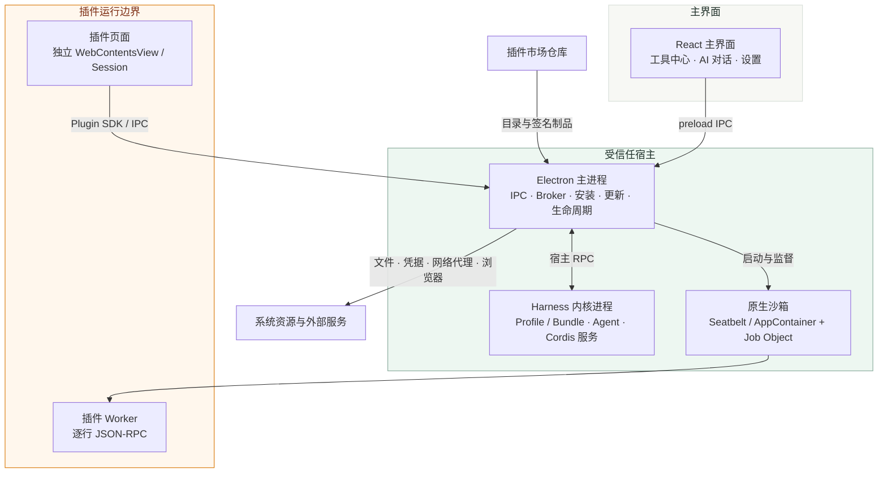
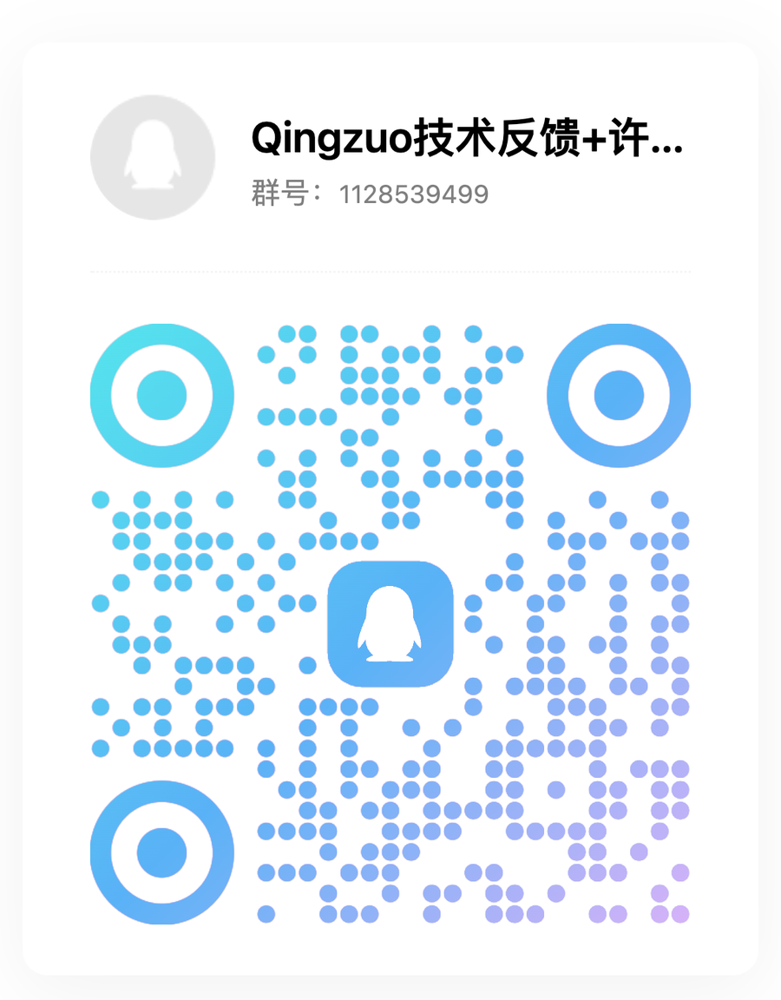

<div align="center">
  
  <h1>轻作 Qingzuo</h1>
  <p><strong>把常用工具装进一个轻巧的桌面工作台。</strong></p>
  <p>
    <a href="https://zhipentu.github.io/qingzuo-desktop/">官网</a> ·
    <a href="https://github.com/ZhiPenTu/qingzuo-desktop/releases/latest">下载</a> ·
    <a href="https://github.com/ZhiPenTu/qingzuo-market">插件市场</a> ·
    <a href="docs/plugin-development.md">插件开发</a> ·
    <a href="#加入-qq-群">参与反馈</a>
  </p>
</div>

轻作是基于 Electron、React、DeepSeek Harness 和系统沙箱的插件式桌面工作台。安装包只包含底座，标签编辑、图片处理等业务工具从插件市场按需安装，并独立更新。

## 核心能力

- **按需扩展**：插件独立安装、停用、卸载和更新，新增工具不需要重新发布底座。
- **可信宿主**：工具中心、市场、设置、更新、凭据和沙箱由受保护的系统服务管理。
- **隔离执行**：插件界面运行在独立会话中，本地程序进入原生系统沙箱；插件代码不会载入 Harness 内核。
- **AI 协作**：AI 对话可以发现插件能力，但每次工具调用都展示冻结参数并由用户确认。
- **双平台**：支持 macOS 15+ Apple Silicon 和 Windows 10+ x64。

## 架构



核心边界只有三条：

1. **界面边界**：渲染进程关闭 Node 集成，只能通过 preload 暴露的窄接口访问宿主。
2. **插件边界**：每个插件使用独立页面会话；文件、凭据、网络和浏览器能力由主进程按清单授权代理。
3. **进程边界**：Harness 只加载受信任的声明式适配器，第三方逻辑在独立 Worker 中运行，并由系统沙箱限制文件和进程访问。

完整的进程拓扑、信任边界、安装流程和调用链见 [架构说明](docs/architecture.md)。

## 快速开始

从 [最新 Release](https://github.com/ZhiPenTu/qingzuo-desktop/releases/latest) 下载对应平台安装包，安装后打开「工具中心」，在「全部」页签里挑选需要的工具。

- macOS：Apple Silicon，macOS 15 或更高版本。
- Windows：x64，Windows 10 或更高版本。

插件、底座和插件 SDK 分别维护版本。底座更新会保留现有用户配置和已安装插件；插件是否兼容由清单中的 API 范围决定。

## 插件生态

| 项目 | 说明 |
| --- | --- |
| [LabelEdit](https://github.com/ZhiPenTu/qingzuo-plugin-labeledit) | PDF 编辑与离线 OCR |
| [AI 抠图](https://github.com/ZhiPenTu/qingzuo-plugin-removebg) | 商品图片背景移除 |
| [AI 批图](https://github.com/ZhiPenTu/qingzuo-plugin-ai-image) | 批量图片编辑与保存 |
| [插件市场](https://github.com/ZhiPenTu/qingzuo-market) | 插件目录、签名制品与发布记录 |

开发新插件可从 `npm run plugin -- create my-tool` 开始，接口、权限、签名和端到端测试见 [插件开发文档](docs/plugin-development.md)。插件界面须沿用底座的暖白、墨绿与深绿灰配色，不得另起品牌主色；完整 token 和明暗模式规则见[插件配色规范](docs/plugin-development.md#第三方界面配色)。

## 本地开发

需要 Node 24、Rust stable；macOS 还需要 Xcode Command Line Tools。

```sh
npm ci --ignore-scripts
node node_modules/electron/install.js
npm run build:harness-native
npm run build:sandbox
npm run build
npm run platform:prepare
npm run desktop:dev
```

常用验证：

```sh
npm test
npm run test:platform
npm run test:sandbox
npm run test:harness-contract
npm run test:desktop
```

`npm run build:desktop` 生成只包含底座的安装包。上游 Harness 包族、锁文件与公开导出的检查使用 `npm run upstream:check`；候选升级流程见 [Harness 整组升级验证](docs/harness-upgrades.md)。

## 仓库结构

| 路径 | 职责 |
| --- | --- |
| `src/` | React 渲染进程界面 |
| `desktop/` | Electron 主进程、Harness 适配、Broker、安装与更新 |
| `native/sandbox/` | Rust 原生沙箱启动器 |
| `packages/plugin-sdk/` | 插件 SDK、清单校验与 CLI |
| `packages/platform-bundle/` | Harness Profile/Bundle 的产品补丁 |
| `scripts/` | 构建、打包、发布与上游检查脚本 |
| `tests/` | 平台契约、Electron 流程与测试夹具 |
| `site/` | GitHub Pages 官方网站 |

## 文档

- [架构说明](docs/architecture.md)
- [插件开发](docs/plugin-development.md)
- [Harness 对话适配](docs/harness-integration.md)
- [Harness 升级流程](docs/harness-upgrades.md)
- [发布与版本流程](docs/release-guide.md)
- [界面设计](docs/design/qingzuo.md)
- [第三方许可与声明](docs/third-party-notices.md)

## 加入 QQ 群

遇到问题、提交建议或交流插件开发，欢迎加入轻作技术反馈群。

**群号：1128539499**

<div align="center">
  
</div>

## License

[MIT](LICENSE)

