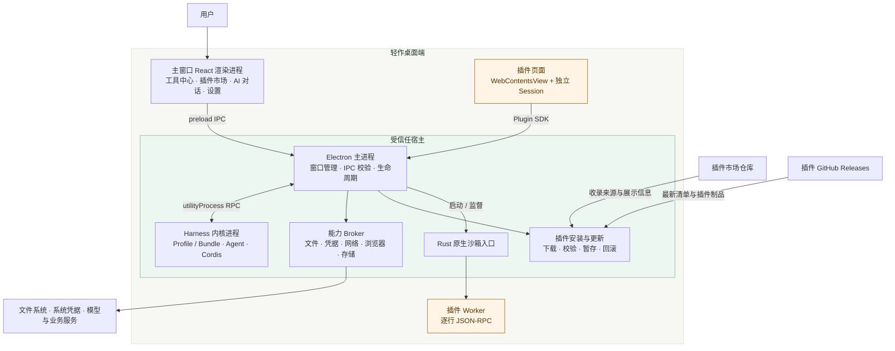
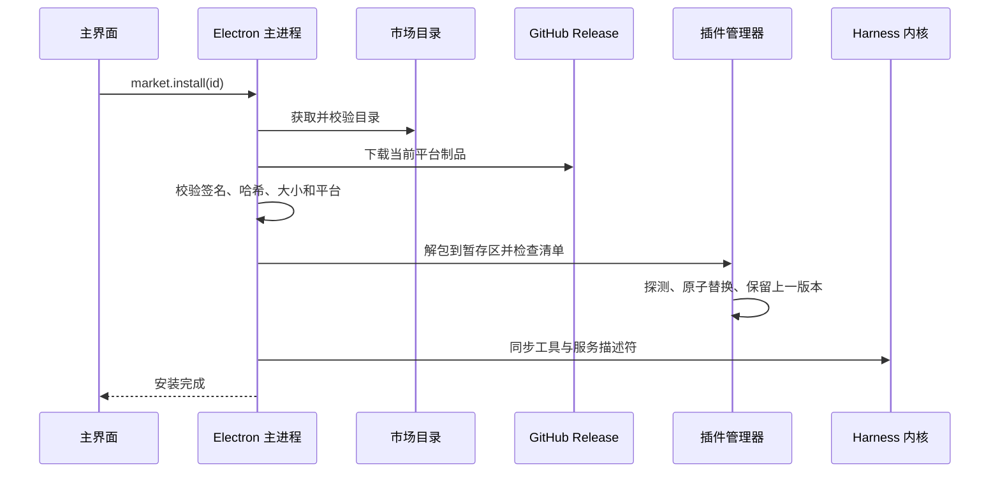
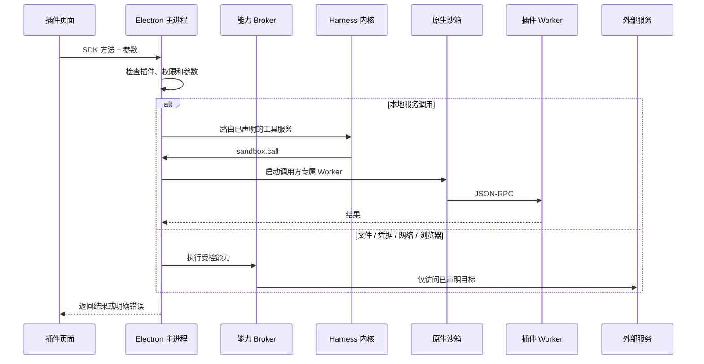

# 轻作架构

轻作把桌面壳、Harness 内核、插件 SDK 和第三方插件放在不同的信任边界内。底座负责系统能力与生命周期，插件只获得清单声明且经宿主代理的能力。

## 设计原则

1. **底座与业务分离**：安装包不内置业务插件，市场目录变化不需要重新发布底座。
2. **第三方代码不进入内核**：Harness 只加载受信任的声明式适配器，插件逻辑在独立页面或 Worker 中运行。
3. **能力显式授权**：文件、凭据、网络、浏览器、存储和 AI 能力都必须出现在插件清单中。
4. **升级可回退**：安装先进入暂存区，校验、探测和同步完成后激活；更新保留上一版本。
5. **上游固定可审查**：Harness 包族、原生加载器和 Electron 组合由 `desktop/upstream/harness.json` 固定，不使用浮动版本。

## 运行拓扑



## 组件职责

| 组件 | 运行位置 | 职责 |
| --- | --- | --- |
| React 主界面 | Electron 渲染进程 | 工具中心、市场、插件管理、设置、更新和 AI 对话 |
| 插件页面 | 独立 `WebContentsView` | 加载插件自带的已构建前端，通过 Plugin SDK 访问宿主 |
| Electron 主进程 | 主进程 | 校验 IPC、限制页面导航、管理窗口、Broker、安装任务和应用更新 |
| Harness 内核 | `utilityProcess` | 运行固定版本 Profile/Bundle、Agent 循环、Cordis 服务和工具注册 |
| 平台系统服务 | Harness 内核中的受信任插件 | 注册工具中心、市场、插件管理、设置、更新、凭据和沙箱服务 |
| 原生沙箱 | Rust 启动器 | 在 macOS Seatbelt 或 Windows AppContainer + Job Object 中启动本地程序 |
| 插件 Worker | 第三方进程 | 执行插件声明的本地服务，通过标准输入输出逐行交换 JSON-RPC |
| Plugin SDK | 插件制品内 | 封装文件、凭据、网络、浏览器、存储、AI、服务和生命周期接口 |

## 信任边界

### 渲染进程

- 主窗口和插件页面都启用 `contextIsolation`，关闭 `nodeIntegration`，页面本身不能读取 Node、文件系统或系统凭据。
- 主窗口只能加载 `commerce://shell/`；插件页面只能加载 `commerce-plugin://<plugin-id>/`。
- 新窗口、页面导航和 WebView 默认阻止，HTTP(S) 链接交给系统浏览器。

### 插件页面

- 每个插件使用 `persist:commerce-<id>` 独立会话，拥有自己的存储分区和权限拒绝策略。
- CSP 和请求拦截禁止页面直接联网；WebRTC 也通过不可达代理禁用非代理连接。
- `plugin-preload.cjs` 只暴露身份绑定的 IPC、AI 事件、浏览器事件和清理回调。
- 文件、凭据、网络和浏览器操作都由主进程重新检查插件身份、启用状态和清单权限。

### Harness 内核

- 内核由 `desktop/kernel-host.mjs` 在独立 utility process 中启动。
- Profile 只装载 `@commerce/platform-bundle` 和固定的 `@deepseek-ai/dsh-*` 服务。
- 插件同步给内核的是描述符，不是 JavaScript 代码；工具服务最终通过沙箱服务路由到插件 Worker。
- 工作台 AI 的插件调用先经过冻结参数和用户确认。插件不能访问工作台对话，也不能把说明文字当作系统指令。

### 本地程序

- Worker 只能读取自身制品和必要运行资源，只能写入私有任务目录。
- 用户文件由系统选择器授权并复制为文件令牌；输出通过宿主保存对话框写入。
- 沙箱不可用时拒绝运行本地程序，不存在普通进程降级路径。
- 停用、卸载、退出和异常恢复都会清理 Worker、任务目录和沙箱策略文件。

## 关键数据流

### 插件安装



取消发生在下载或校验阶段时会终止任务；进入原子安装事务后，宿主先完成当前事务再退出或在下次启动恢复。

### 插件工具调用



### AI 调用插件

1. Harness Agent 通过 `list_plugins` 读取已启用插件和声明工具。
2. 模型请求 `call_plugin` 时，宿主校验工具参数并生成确认记录。
3. 用户在界面确认后，宿主再次检查插件版本、工具定义和启用状态。
4. 调用在独立 Worker 中执行；拒绝、取消、停用、卸载或版本变化都不会触发调用。
5. 未知结果不会自动重试，避免重复产生外部副作用或费用。

## 仓库映射

```text
src/                       主窗口 React 界面
desktop/                   主进程、Harness 适配、Broker、安装与更新
native/sandbox/            Rust 原生沙箱
packages/plugin-sdk/       插件公开 API、清单校验、模板与 CLI
packages/platform-bundle/  Harness Profile/Bundle 产品补丁
scripts/                   构建、打包、发布和上游检查
tests/platform/            服务、权限、安全与生命周期契约
tests/electron/            真实 Electron 流程
```

## 相关文档

- [插件开发](plugin-development.md)
- [Harness 对话适配](harness-integration.md)
- [Harness 整组升级](harness-upgrades.md)
- [发布与独立插件](release-guide.md)
- [第三方许可与声明](third-party-notices.md)
