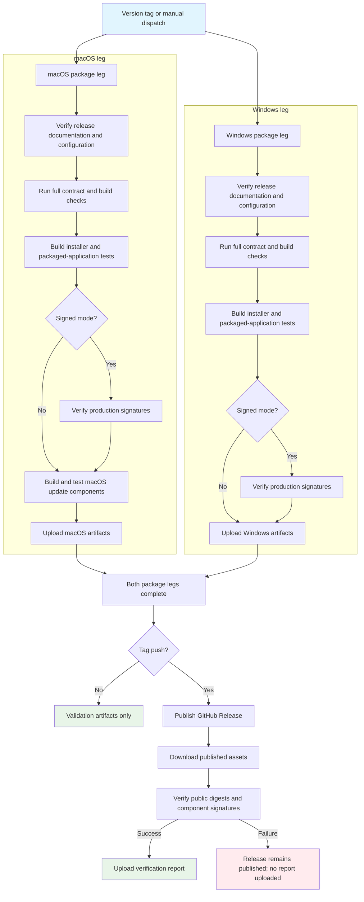

## Workflow Overview

**Purpose**: Build, verify, and publish signed or documented unsigned desktop installers and update components for macOS and Windows, with a post-publication integrity check.
**Trigger Events**: Push of any tag beginning with `v`; the release configuration check then requires the tag to equal `v<package version>`. Manual validation dispatch with an explicit version and signing mode.
**Target Environments**: Production GitHub Release for tag pushes; artifact-only validation for manual dispatch.

## Execution Flow Diagram



## Jobs & Dependencies

| Job Name | Purpose | Dependencies | Execution Context |
|----------|---------|--------------|-------------------|
| package | Validate, package, sign, and upload per-platform artifacts | None | GitHub-hosted macOS and Windows runners, parallel matrix |
| publish | Create the public release and verify its bytes | Both package legs | GitHub-hosted Linux runner, tag pushes only |

The publish job is skipped for manual dispatch. A failure in either package leg prevents publication.

## Requirements Matrix

### Functional Requirements
| ID | Requirement | Priority | Acceptance Criteria |
|----|-------------|----------|-------------------|
| REQ-001 | Enforce version identity | High | Release tag, package version, and manual validation version agree |
| REQ-002 | Require release notes | High | A version-specific release note exists before packaging a tag |
| REQ-003 | Validate release configuration | High | When signed mode is selected, required signing/notarization variables are present; plugin signing key is always required, Ed25519, and matches the configured public key |
| REQ-004 | Reject preview configuration | High | A local-preview environment can never produce a release |
| REQ-005 | Validate both platforms | High | Both macOS and Windows complete all checks and packaging |
| REQ-006 | Produce standalone installers | High | Platform installer artifacts are generated and smoke-tested |
| REQ-007 | Produce macOS update components | High | Components are rebuilt and the update flow is verified |
| REQ-008 | Verify production signatures | High | Signed mode validates every expected production signature |
| REQ-009 | Publish only from tags | High | Manual dispatch never creates or modifies a public release |
| REQ-010 | Verify published integrity | High | Published asset digests, updater SHA-512 values, and component signatures are internally consistent with GitHub's recorded digests and the signed manifest |
| REQ-011 | Preserve successful verification evidence | Medium | A public-release verification report is retained as an artifact after verification passes |
| REQ-012 | Support unsigned distribution | Medium | Unsigned mode is selected explicitly for manual dispatch or by the documented repository fallback for tag pushes; plugin signing remains mandatory |

### Security Requirements
| ID | Requirement | Implementation Constraint |
|----|-------------|---------------------------|
| SEC-001 | Least-privilege build | Packaging jobs have read-only repository access |
| SEC-002 | Scoped publication | Only the publish job may write release contents |
| SEC-003 | Private key isolation | Signing keys and platform credentials are injected only into package jobs |
| SEC-004 | Key integrity | Plugin signing key must be Ed25519 and match the configured public key |
| SEC-005 | No local preview | Preview mode is rejected before any build |
| SEC-006 | Public key separation | Plugin and market keys are configured independently; no automated equality check is performed |
| SEC-007 | Tag authority | A tag push is the release authorization; restricting tag creation to release owners is an external repository-permission control, not enforced by this workflow |

### Performance Requirements
| ID | Metric | Target | Measurement Method |
|----|--------|--------|-------------------|
| PERF-001 | Package duration | No explicit target; establish baseline per platform | Job duration |
| PERF-002 | Repeat cost | Dependency and Rust caches reused | Cache hit indicators |
| PERF-003 | Publication latency | Publish starts only after both platform legs succeed | Job dependency graph |

## Input/Output Contracts

### Inputs

```yaml
# Tag trigger
tag_name: "vX.Y.Z"  # Must equal the package version

# Manual dispatch
version: string      # Required; must equal the package version
signing: unsigned | signed  # Defaults to unsigned

# Applies to tag pushes only; manual dispatch always supplies its choice input.
# Tag pushes fall back to `unsigned` when unset.
COMMERCE_DESKTOP_SIGNING: unsigned | signed
```

The manual dispatch path is validation-only and never publishes.

### Outputs

```yaml
Commerce-macOS: artifact       # Contents: disk image, ZIP, blockmaps, update manifest, component manifest, component archives
Commerce-Windows: artifact     # Contents: installer, blockmap, update manifest
Public-release-verification: artifact  # Contents: verification.json only (version, release URL, per-asset SHA-256/SHA-512, component IDs)
```

Public release assets: macOS disk image, ZIP, and their blockmaps; Windows installer and blockmap; `latest-mac.yml` and `latest.yml`; the signed `CommerceTools-<version>-mac-arm64.components.json` manifest; and the `core`, `electron`, and `dependencies` component archives. Release notes come from the version-specific release document.

### Secrets & Variables

| Type | Name | Purpose | Scope |
|------|------|---------|-------|
| Secret | COMMERCE_PLUGIN_SIGNING_KEY | Sign plugin/update metadata | Package job |
| Secret | MAC_CSC_LINK | macOS signing certificate; exported as `CSC_LINK` on the macOS leg | macOS package leg |
| Secret | MAC_CSC_KEY_PASSWORD | macOS certificate password; exported as `CSC_KEY_PASSWORD` on the macOS leg | macOS package leg |
| Secret | WIN_CSC_LINK | Windows signing certificate; exported as `CSC_LINK` on the Windows leg | Windows package leg |
| Secret | WIN_CSC_KEY_PASSWORD | Windows certificate password; exported as `CSC_KEY_PASSWORD` on the Windows leg | Windows package leg |
| Secret | APPLE_ID | macOS notarization identity; injected into both package legs | Both package legs |
| Secret | APPLE_APP_SPECIFIC_PASSWORD | macOS notarization credential; injected into both package legs | Both package legs |
| Secret | APPLE_TEAM_ID | macOS notarization team; injected into both package legs | Both package legs |
| Variable | COMMERCE_PLUGIN_PUBLIC_KEY | Verify plugin signatures | Repository |
| Variable | COMMERCE_MARKET_PUBLIC_KEY | Verify market metadata | Repository |
| Variable | COMMERCE_DESKTOP_SIGNING | Signing mode for tag pushes; dispatch always supplies its own input (default unsigned) | Repository |
| Token | GITHUB_TOKEN | Read repository contents; publish job also writes releases | Workflow / publish job |

## Execution Constraints

### Runtime Constraints

- **Timeout**: No workflow-specific timeout; GitHub's default per-job limit applies.
- **Concurrency**: No concurrency group is defined. Concurrent tag builds or reruns can overlap.
- **Resource Limits**: Standard GitHub-hosted runners; packaging and notarization are the dominant costs.

### Environmental Constraints

- **Runner Requirements**: Current GitHub-hosted macOS and Windows images with the project's pinned Node and Rust toolchains, platform signing tools, and macOS notarization tooling.
- **Network Access**: Package registry, Electron binaries, pinned upstream sources, Apple notarization services, and GitHub release APIs.
- **Permissions**: Build jobs read-only; publish job writes repository contents.
- **Artifact Retention**: Package artifacts are uploaded only when the job reaches the upload step successfully.
- **Approvals**: No GitHub Environment or deployment approval is configured.

## Error Handling Strategy

| Error Type | Response | Recovery Action |
|------------|----------|-----------------|
| Missing release note | Tag build fails before packaging | Add the version-specific note and re-tag or rerun |
| Version or tag mismatch | Configuration check fails | Align `package.json` with the tag; lockfile consistency is enforced pre-merge by branch policy; version must be `X.Y.Z` and at least `0.2.0` |
| Preview mode detected | Configuration check fails | Remove preview configuration and rebuild |
| Missing or invalid signing material in signed mode | Configuration check fails | Restore the correct secret or switch explicitly to unsigned mode |
| Platform build failure | That leg fails; publication is blocked | Fix the platform-specific issue and rerun |
| Signature verification failure | Package leg fails; publication is blocked | Correct signing configuration and rebuild |
| Publication failure | A public release may exist with a partial asset set; publication is not transactional | Delete or repair the release, then rerun |
| Post-publication verification failure | Release remains public; verification artifact is absent because the upload step is not reached | Treat as a release incident and remediate or republish |
| Concurrent tag or rerun | Overlapping runs may race on the same release | Serialize manually and inspect the release before rerunning |

## Quality Gates

### Gate Definitions

| Gate | Criteria | Bypass Conditions |
|------|----------|-------------------|
| Release identity | Tag and package versions match | None |
| Release documentation | Version-specific release note exists | Manual dispatch |
| Release configuration | Required credentials present for the selected signing mode; plugin key Ed25519 and matched; preview mode absent | Unsigned signing mode (plugin signing still required) |
| Full validation | All contract, build, sandbox, and desktop suites pass | None |
| Installer smoke | Both platform installers build and pass smoke checks | None |
| Production signatures | Platform tools validate certificates, application bundle, and Windows binaries | Unsigned mode |
| Public integrity | GitHub digests, updater SHA-512 values, and component signatures are internally consistent | None |

## Monitoring & Observability

### Key Metrics

- **Release Success Rate**: Successful tag builds divided by tag pushes.
- **Duration**: Per-platform packaging and notarization time.
- **Signature Failures**: Count and platform distribution.
- **Public Verification Failures**: Any occurrence is a release incident.
- **Artifact Completeness**: Presence of all expected installer and update assets.

### Alerting

| Condition | Severity | Notification Target |
|-----------|----------|-------------------|
| Tag build fails before publication | High | Release owners |
| Post-publication verification fails | Critical | Release owners and security owners |
| Signing or notarization failure | High | Release owners |
| Repeated platform-specific packaging failure | Medium | Desktop maintainers |
| Overlapping release runs | Medium | Release operators |

## Integration Points

### External Systems

| System | Integration Type | Data Exchange | SLA Requirements |
|--------|------------------|---------------|------------------|
| GitHub Releases | Publication and verification | Installers, manifests, components, notes | Available during publish and verification |
| Apple notarization | Signing service | Signed application bundle | Available for signed macOS builds |
| npm registry | Dependency source | Packages and lockfile metadata | Available during install |
| Pinned upstream source | Build input | Harness packages and metadata | Must match the committed pin |
| Update clients | Consumer contract | Update manifests and components | Assets must remain byte-stable after publication |

### Dependent Workflows

| Workflow | Relationship | Trigger Mechanism |
|----------|--------------|-------------------|
| Validate commerce desktop | Pre-merge parity check for the same build and test intent | Pull request |
| Branch policy | Enforces the `codex/` branch prefix, branch flow, title, version consistency, and conflict-free merge | Pull request to `develop` or `main` |
| Auto version | Maintains the version consumed by the release tag | Merge into `develop` |
| Release plugin SDK | Independent SDK release channel | SDK-specific tag |
| Pages | Publishes the official site from the production branch | Push to `main` touching the site |

## Compliance & Governance

### Audit Requirements

- **Execution Logs**: Retained under the repository's GitHub Actions retention setting.
- **Release Evidence**: Platform artifacts and the public verification report are retained per artifact policy.
- **Approval Gates**: Production publication is authorized by creating and pushing a version tag. Restricting tag creation is an organizational repository-permission requirement; the workflow does not verify the actor.
- **Change Control**: This specification is updated before changing release assets, signing policy, or publication steps.

### Security Controls

- **Access Control**: Job-scoped permissions; build jobs cannot write releases.
- **Secret Management**: Signing and notarization credentials are injected as job/step environment variables and never committed; GitHub Environments are not used.
- **Key Validation**: The plugin private/public key algorithm and match are checked before building. Platform certificate validity is checked by platform tools only in signed mode.
- **Supply Chain**: Upstream versions and lockfiles are verified before packaging.
- **Public Verification**: Published bytes are re-downloaded and checked after release creation.
- **Vulnerability Scanning**: No dedicated scanner runs in this workflow; dependency, signature, and public-digest checks are the available controls.

## Edge Cases & Exceptions

### Scenario Matrix

| Scenario | Expected Behavior | Validation Method |
|----------|-------------------|-------------------|
| Manual dispatch with matching version | Artifacts produced; no public release | Inspect release list and artifacts |
| Manual dispatch with mismatched version | Preflight fails | Inspect job log |
| Tag without release note | Build fails before packaging | Inspect job log |
| Tag does not match package version | Build fails before packaging | Inspect job log |
| Any `v*` tag with a malformed or preview version | Preflight fails before building | Inspect job log |
| Signed mode without certificates | Preflight fails | Inspect job log |
| Unsigned mode | Installers produced; plugin signing still enforced | Inspect preflight and signature steps |
| Tag push without signing mode variable | Falls back to unsigned; plugin signing still required | Inspect the resolved signing mode in the job log |
| macOS component test failure | macOS leg fails; publication blocked | Inspect package job status |
| Publish rerun after release exists | Release creation fails; manual cleanup required | Inspect publish job log |
| Public verification failure | Release already public; no verification artifact is uploaded | Inspect publish job log and live release assets |
| Two tags built concurrently | Runs overlap without serialization | Inspect workflow run history |
| macOS runtime check on Windows | Script performs no work off macOS | Confirm Windows leg succeeds |

## Validation Criteria

### Workflow Validation

- **VLD-001**: Tag pushes and manual dispatch follow different publication paths.
- **VLD-002**: Both platform legs must succeed before publication.
- **VLD-003**: Version identity is enforced for both trigger modes.
- **VLD-004**: Release notes are required only for tag publication.
- **VLD-005**: Private signing material is absent from build logs and artifacts.
- **VLD-006**: The publish job is the only job with write permission.
- **VLD-007**: Public assets are re-downloaded and verified after publication.
- **VLD-008**: Manual dispatch cannot create a public release.
- **VLD-009**: Tag input is filtered by the `v*` prefix, with exact version equality enforced during configuration validation.
- **VLD-010**: Plugin key algorithm and pair matching are validated; platform certificate validity is delegated to signed-mode verification.

### Performance Benchmarks

- **PERF-001**: Warm-cache packaging is materially shorter than cold-cache packaging.
- **PERF-002**: Publication latency is bounded by the slower platform leg, not by sequential platform execution.

## Change Management

### Update Process

1. **Specification Update**: Modify this document first.
2. **Review & Approval**: Require release-owner and security review for signing, asset, or publication changes.
3. **Implementation**: Apply the workflow change.
4. **Testing**: Exercise both manual validation and a non-production tag path.
5. **Deployment**: Merge through branch policy; publish only through the approved tag process.

### Version History

| Version | Date | Changes | Author |
|---------|------|---------|--------|
| 1.0 | 2026-11-04 | Initial specification | Codex |

## Related Specifications

- [Validate Commerce Desktop](spec-process-cicd-validate-commerce-desktop.md)
- [Branch Policy Workflow](../../.github/workflows/branch-policy.yml)
- [Release Governance Guide](../release-guide.md)
