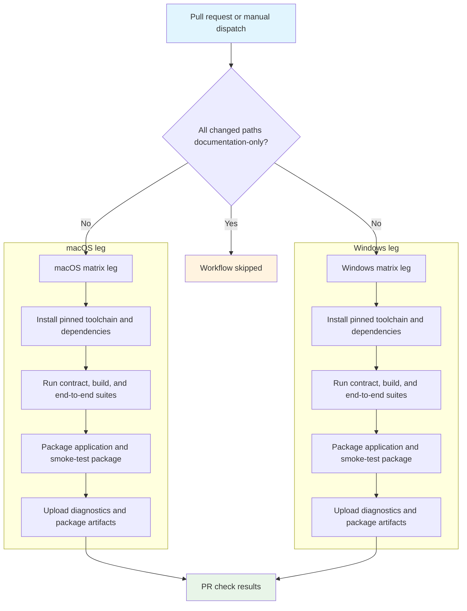

## Workflow Overview

**Purpose**: Prove that every non-documentation change to the desktop base still builds, passes its contract suites, and produces a launchable package on both supported operating systems before merge.
**Trigger Events**: Pull requests whose changed paths are not entirely covered by the documentation/site ignore list; manual dispatch.
**Target Environments**: GitHub-hosted macOS and Windows runners. Builds are unsigned validation builds; outputs are workflow artifacts, never public releases.

## Execution Flow Diagram



## Jobs & Dependencies

| Job Name | Purpose | Dependencies | Execution Context |
|----------|---------|--------------|-------------------|
| desktop | Validate one operating system per matrix leg | None | GitHub-hosted macOS and Windows runners, executed in parallel |

Both matrix legs run independently; a failure on one platform does not cancel the other.

## Requirements Matrix

### Functional Requirements
| ID | Requirement | Priority | Acceptance Criteria |
|----|-------------|----------|-------------------|
| REQ-001 | Validate macOS and Windows | High | One successful result per supported platform |
| REQ-002 | Verify pinned upstream dependencies | High | Upstream pin and lockfile consistency check passes |
| REQ-003 | Verify frontend and platform contracts | High | Frontend, platform, plugin, security, and kernel contract suites pass |
| REQ-004 | Verify the sandbox | High | Native sandbox release build and its regression suite pass |
| REQ-005 | Verify Electron behavior | High | End-to-end desktop suite passes against a real Electron application |
| REQ-006 | Verify packaged application | High | Directory package launches and passes packaged-application smoke checks |
| REQ-007 | Verify macOS component updates | Medium | macOS leg rebuilds components and validates the update flow |
| REQ-008 | Enforce macOS runtime compatibility | High | Every shipped Mach-O binary declares a deployment target no newer than macOS 15.0 |
| REQ-009 | Preserve diagnostics best-effort | Medium | Upload is attempted after success or failure; missing output paths only warn and produce no artifact |
| REQ-010 | Skip documentation-only changes | Medium | Workflow does not start when every changed path is ignored |
| REQ-011 | Cancel superseded runs | Medium | A newer run on the same pull request cancels the older run |

### Security Requirements
| ID | Requirement | Implementation Constraint |
|----|-------------|---------------------------|
| SEC-001 | Read-only repository access | Workflow token is limited to reading repository contents |
| SEC-002 | No production signing | Automatic signing discovery is disabled and signing mode is forced to unsigned |
| SEC-003 | No private release material | Only public verification keys are injected; no signing or notarization secrets are available |
| SEC-004 | Untrusted pull-request isolation | Fork-originated code runs without repository secrets and with a read-only token |
| SEC-005 | No production endpoints | Validation must not target live release or market publication |

### Performance Requirements
| ID | Metric | Target | Measurement Method |
|----|--------|--------|-------------------|
| PERF-001 | Wall-clock duration | No explicit target; establish baseline from run history | Workflow run duration |
| PERF-002 | Repeat build cost | Dependency and Rust caches reused between runs | Cache hit indicators in job logs |
| PERF-003 | Obsolete work | Superseded pull-request runs cancelled | Run status and concurrency group |

## Input/Output Contracts

### Inputs

```yaml
# Event inputs
event: pull_request | workflow_dispatch
changed_paths: path list  # Purpose: decide whether validation is required

# Repository variables
COMMERCE_PLUGIN_PUBLIC_KEY: public_key  # Purpose: verify plugin signatures
COMMERCE_MARKET_PUBLIC_KEY: public_key  # Purpose: verify market metadata

# Fixed environment
CSC_IDENTITY_AUTO_DISCOVERY: "false"
CSC_FOR_PULL_REQUEST: "true"
COMMERCE_DESKTOP_SIGNING: "unsigned"
```

Ignored paths: documentation, the official site, root Markdown files, the Pages workflow, Git ignore rules, and the license. A pull request that also changes any other path is validated.

### Outputs

```yaml
Commerce-validation-macOS: artifact  # Contents: Electron traces, update validation output, packaged application
Commerce-validation-Windows: artifact  # Contents: Electron traces, packaged application
```

Artifacts upload on success and failure. When no matching files exist, the upload step warns and no artifact is retained. Retention follows the repository Actions setting; artifacts are not release assets and carry no publication authority.

### Secrets & Variables

| Type | Name | Purpose | Scope |
|------|------|---------|-------|
| Variable | COMMERCE_PLUGIN_PUBLIC_KEY | Verify plugin artifact signatures | Repository |
| Variable | COMMERCE_MARKET_PUBLIC_KEY | Verify market metadata signatures | Repository |
| Secret | None | Validation intentionally uses no secrets | — |

## Execution Constraints

### Runtime Constraints

- **Timeout**: No workflow-specific timeout; GitHub's default per-job limit applies.
- **Concurrency**: One active run per workflow, event, and source reference; newer pull-request runs cancel older ones.
- **Resource Limits**: Standard GitHub-hosted runner capacity; the two platform legs compete only for repository-level cache and concurrency capacity.

### Environmental Constraints

- **Runner Requirements**: Current GitHub-hosted macOS and Windows images with the project's pinned Node and Rust toolchains and platform build tooling.
- **Network Access**: Package registry, Electron binary download, GitHub APIs, and pinned upstream sources.
- **Permissions**: Repository contents read-only; no write scopes, environments, or approvals.
- **Generated State**: Platform preparation removes stale generated directories before packaging.

## Error Handling Strategy

| Error Type | Response | Recovery Action |
|------------|----------|-----------------|
| Dependency or toolchain failure | Affected platform leg fails; the other continues | Fix the pin or environment, then rerun the workflow |
| Contract or unit test failure | Job stops at the failing suite | Reproduce locally, fix, and push a new commit |
| Build or sandbox failure | Job fails before packaging | Fix the build; do not weaken TypeScript strictness |
| Packaged-application smoke failure | Job fails after packaging | Inspect uploaded traces and package, then fix the regression |
| Binary requires a newer macOS than allowed | macOS leg fails | Lower the offending binary's deployment target to 15.0 or earlier, or replace it; do not raise the macOS 15 product floor |
| Artifact upload failure | Job is marked failed even if checks passed | Rerun after resolving storage or permission issues |
| Superseded run | Older run is cancelled | Use the newest run as the authoritative result |
| Documentation-only pull request | Workflow is not created; if this workflow is a required check, the PR stays pending | Keep it out of required checks or add a matching no-op job |

## Quality Gates

### Gate Definitions

| Gate | Criteria | Bypass Conditions |
|------|----------|-------------------|
| Cross-platform build | Both matrix legs succeed | None for runs that start; enforcement depends on required-check configuration |
| Contract suites | All frontend, platform, plugin, security, and kernel contracts pass | None |
| Desktop behavior | End-to-end Electron suite passes | None |
| Package smoke | Packaged application passes platform smoke checks | None |
| Runtime compatibility | macOS binaries require no newer than macOS 15.0 | None |
| Documentation-only change | No code, workflow, or build input changed | Ignored-path filter |

## Monitoring & Observability

### Key Metrics

- **Success Rate**: Track per-platform pass rate to detect runner-image drift.
- **Execution Time**: Watch for duration growth after dependency or Electron upgrades.
- **Flaky Suites**: Compare failures across reruns before attributing them to a code change.
- **Artifact Size**: Detect accidental bundling of generated or business assets.

### Alerting

| Condition | Severity | Notification Target |
|-----------|----------|-------------------|
| Repeated failure on one platform only | High | Repository maintainers |
| macOS runtime compatibility violation | High | Desktop release owners |
| Cache or toolchain download failure | Medium | Repository maintainers |
| Artifact upload failure | Low | Repository maintainers |

## Integration Points

### External Systems

| System | Integration Type | Data Exchange | SLA Requirements |
|--------|------------------|---------------|------------------|
| GitHub Actions | Execution platform | Workflow status and artifacts | Standard hosted-runner availability |
| npm registry | Dependency source | Packages and lockfile metadata | Available during install |
| Pinned upstream source | Build input | Harness packages and metadata | Must match the committed pin |
| Electron distribution | Runtime input | Electron binary | Available during setup |

### Dependent Workflows

| Workflow | Relationship | Trigger Mechanism |
|----------|--------------|-------------------|
| Branch policy | Independent merge gate | Pull request to `develop` or `main` |
| Release commerce desktop | Reuses the same validation intent with additional release checks | Version tag or manual dispatch |
| Auto version | Follows a merge into `develop` | Closed pull request |
| Upstream upgrade check | Overlaps on Harness-related paths | Path-filtered pull request, schedule, or dispatch |

## Compliance & Governance

### Audit Requirements

- **Execution Logs**: Retained under the repository's GitHub Actions retention setting.
- **Approval Gates**: `Branch policy` is the documented required check. Whether this workflow is also required must be verified in repository settings, not assumed.
- **Change Control**: This specification is updated before changing validation scope or platform support.

### Security Controls

- **Access Control**: Read-only token; no environment secrets.
- **Secret Management**: No private keys are exposed to validation runs.
- **Supply Chain**: Upstream versions are pinned and checked for lockfile consistency.
- **Vulnerability Scanning**: No dedicated scanner runs in this workflow; dependency and signature checks are the available controls.

## Edge Cases & Exceptions

### Scenario Matrix

| Scenario | Expected Behavior | Validation Method |
|----------|-------------------|-------------------|
| Pull request changes only documentation | Workflow is skipped; a required-check configuration would leave the PR pending | Confirm no run is created and inspect check status |
| Pull request mixes documentation and code | Full validation runs | Inspect changed-path filter result |
| Fork pull request | Runs with a read-only token and no secrets; repository variables may still be available | Inspect environment and check result |
| macOS-only runtime check on Windows | Script performs no work off macOS | Confirm Windows leg succeeds |
| Manual dispatch on a branch | Both platforms validate the branch state | Inspect run metadata |
| Cache unavailable | Jobs still complete with slower cold builds | Clear cache in a test run |
| One platform fails early | Other platform continues to completion | Inspect matrix leg statuses |

## Validation Criteria

### Workflow Validation

- **VLD-001**: Both supported platforms appear as independent matrix legs.
- **VLD-002**: A failure on one platform does not cancel the other.
- **VLD-003**: Documentation-only changes do not start the workflow.
- **VLD-004**: No production signing material is referenced.
- **VLD-005**: The upload step runs after both success and failure; artifacts exist only when matching output files were produced.
- **VLD-006**: The macOS runtime compatibility ceiling is checked before and after packaging.
- **VLD-007**: Concurrency cancels superseded pull-request runs.

### Performance Benchmarks

- **PERF-001**: Warm-cache runs are materially shorter than cold-cache runs.
- **PERF-002**: Duration regressions after toolchain upgrades are investigated before merge.

## Change Management

### Update Process

1. **Specification Update**: Modify this document first.
2. **Review & Approval**: Obtain maintainer review for scope, platform, or security changes.
3. **Implementation**: Apply the workflow change.
4. **Testing**: Validate on a pull request that exercises both platforms.
5. **Deployment**: Merge through the normal branch policy.

### Version History

| Version | Date | Changes | Author |
|---------|------|---------|--------|
| 1.0 | 2026-11-04 | Initial specification | Codex |

## Related Specifications

- [Release Commerce Desktop](spec-process-cicd-release-commerce-desktop.md)
- [Branch Policy Workflow](../../.github/workflows/branch-policy.yml)
- [Release Governance Guide](../release-guide.md)
